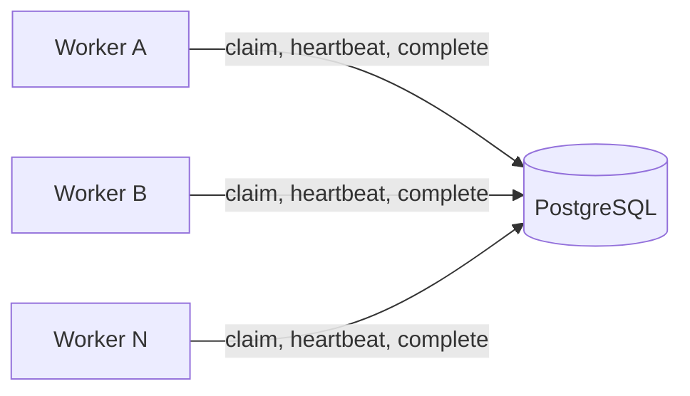
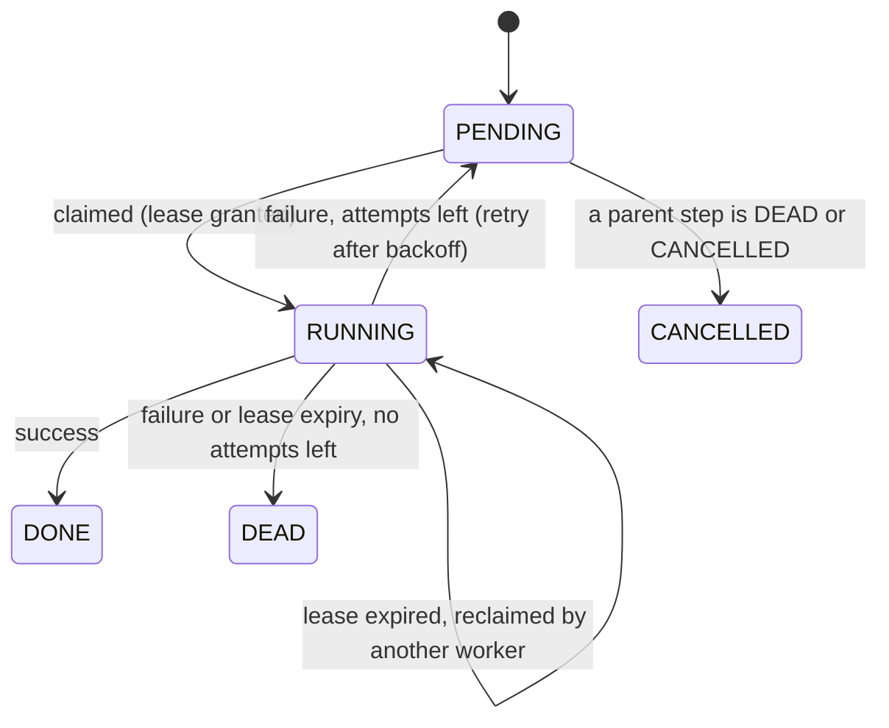

# Durable Workflow Engine

A small workflow engine built on **PostgreSQL** and **.NET 10**. It runs multi-step workflows (DAGs) across several worker processes and keeps going when workers crash, stall or fail.

I built it to understand why tools like Temporal and Airflow exist: what has to be true for background work to survive crashes, retry safely and never silently disappear.

## Chaos test results

250 steps (50 workflows of 5 steps each) were run by 4 workers while a script killed a random worker every 5 seconds.

| Check | Result |
|---|---|
| Worker kills during the run | 21 |
| Total run time | 117 seconds |
| Steps finished | **250 of 250** (none lost) |
| Steps that finished before a step they depend on | **0** |
| Steps executed more than once (rescued after a kill) | 18 (no step ran more than twice) |
| Total step executions | 268 |

The 18 repeats are expected: execution is **at-least-once**. When a worker dies mid-step, another worker re-runs that step. Real step handlers must therefore be idempotent (safe to run twice).

Each step simulates 1.5 seconds of work, so these numbers show correctness under failure, not raw throughput.

## How it works



All state lives in Postgres: steps, dependencies and execution history. Workers are stateless, so any number can run in parallel and any of them can crash at any time.

### Claiming work safely

A worker claims a ready step with one atomic statement (simplified):

```sql
UPDATE jobs
SET status = 'RUNNING', claimed_by = $1,
    lease_expires_at = now() + interval '8 seconds',
    attempts = attempts + 1
WHERE id = (
    SELECT j.id FROM jobs j
    WHERE (j.status = 'PENDING' AND j.run_after <= now()
           AND NOT EXISTS (SELECT 1 FROM job_dependencies d
                           JOIN jobs p ON p.id = d.depends_on_id
                           WHERE d.job_id = j.id AND p.status <> 'DONE'))
       OR (j.status = 'RUNNING' AND j.lease_expires_at < now())
    ORDER BY j.id
    FOR UPDATE OF j SKIP LOCKED
    LIMIT 1
)
RETURNING id;
```

- `FOR UPDATE SKIP LOCKED` means a worker never waits for a row another worker is claiming. It skips to the next ready step.
- The `NOT EXISTS` clause is what makes a step wait until all its parents are `DONE`.
- The second condition rescues steps whose worker died (expired lease).

### Leases, heartbeats and fencing

- Claiming a step grants an **8-second lease**.
- While working, a worker **renews the lease every 3 seconds** (heartbeat). If the worker dies, heartbeats stop and the lease expires.
- **Fencing:** every completion is `UPDATE ... WHERE claimed_by = me AND status = 'RUNNING'`. If the lease was lost and the step reassigned, the update changes 0 rows and the old worker's result is discarded.
- All lease timing uses the **database clock** (`now()`), never worker clocks, so clock skew between machines doesn't matter.

### Step states



### Retries

A failed step is retried with **exponential backoff and jitter**: about 2s, 4s, 8s... capped at 30s, multiplied by a random factor between 0.5 and 1.5 so failing steps don't all retry at the same moment. After 3 attempts the step becomes `DEAD`. Steps that depend on it are marked `CANCELLED` without ever running.

## Guarantees

- **At-least-once execution.** A step may run more than once, never zero times (unless it is `DEAD` or `CANCELLED`).
- **Dependency order.** A step never starts before all its parents are `DONE`.
- **No double claiming.** Two workers cannot claim the same step at the same moment. If a lease expires, the step is reassigned and the old worker's result is rejected.
- **Not exactly-once.** Exactly-once is not achievable across a network boundary. Step handlers should be idempotent.

## Failure modes and how they are handled

| Failure | How it is detected | What happens |
|---|---|---|
| Worker crashes mid-step | Lease expires (8s) | Another worker reclaims the step, attempt count increases |
| Worker is slow, not dead | Heartbeat keeps arriving | Lease is renewed, step is left alone |
| "Zombie" worker finishes after losing its lease | Fencing check updates 0 rows | Its result is discarded, it stops working |
| Step fails | Handler reports failure | Retry with exponential backoff and jitter |
| Step always fails (poison step) | Attempts reach the maximum | Step marked `DEAD` |
| Worker keeps crashing on a step's last attempt | Lease expired with no attempts left | Step marked `DEAD` instead of retrying forever |
| A parent step is `DEAD` | Dependency check | All descendants marked `CANCELLED` |
| Worker clocks disagree | Not applicable | All timing uses the database clock |

## Run it

Prerequisites: [.NET 10 SDK](https://dotnet.microsoft.com/download/dotnet/10.0) and Docker Desktop.

```
git clone https://github.com/damarisnteseng-bot/durable-workflow-engine.git
cd durable-workflow-engine
docker compose up -d
type db\seed.sql | docker exec -i workflow-postgres psql -U workflow -d workflow
dotnet build src/Worker
dotnet run --project src/Worker --no-build -- worker-A
```

(On macOS/Linux use `cat db/seed.sql | ...` instead of `type`.) Start a second worker in another terminal with `worker-B` to watch the two share the work.

To run the chaos test (Windows PowerShell), reseed the database and run:

```
type db\seed.sql | docker exec -i workflow-postgres psql -U workflow -d workflow
powershell -ExecutionPolicy Bypass -File .\chaos.ps1
```

Postgres is exposed on port 5433. The development password is only for local use.

## Design decisions

- **Postgres instead of Kafka or Redis.** Job state, dependencies and the queue live in one transactional store, so a claim and a state change can never disagree. The trade-offs are polling (workers check every second) and a single database as the throughput ceiling. I would move to a dedicated broker for very high throughput or multi-region workloads.
- **Leases instead of locks.** A lock held by a dead worker blocks forever. A lease expires on its own.
- **Lease longer than heartbeat interval.** An 8-second lease with a 3-second heartbeat tolerates one missed heartbeat without a false takeover.

## Bugs the tests caught

- **Livelock without heartbeats.** A 20-second step with an 8-second lease was stolen repeatedly by two workers, and neither could finish it. Heartbeats fixed this.
- **Attempts exceeding the maximum.** A step whose lease kept expiring never reported a failure, so it skipped the "give up after 3 attempts" rule (attempt counts reached 12). It is now marked `DEAD` once its lease expires with no attempts left.

## Limitations and roadmap

Not built yet:

- REST API for submitting workflows, and workflow definitions in YAML with cycle detection (workflows are currently inserted with SQL)
- Prometheus metrics, tracing and a dashboard
- Idempotency keys passed to handlers
- Graceful handling of a database outage (workers currently crash if Postgres is unreachable)
- `LISTEN/NOTIFY` to replace polling
- Real step handlers (steps currently simulate work)
- CI with GitHub Actions