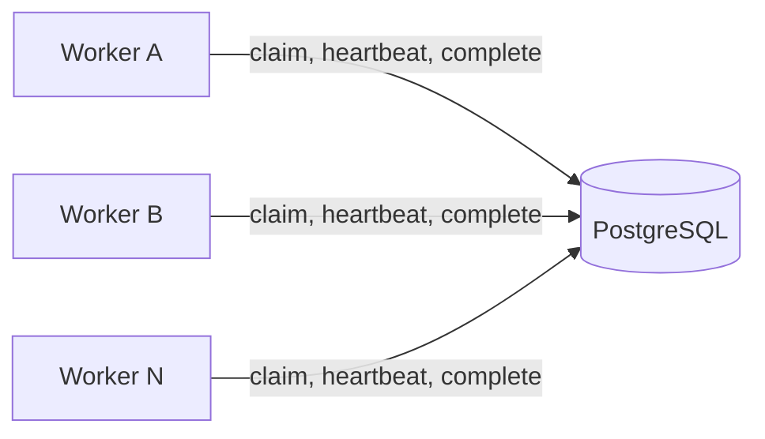
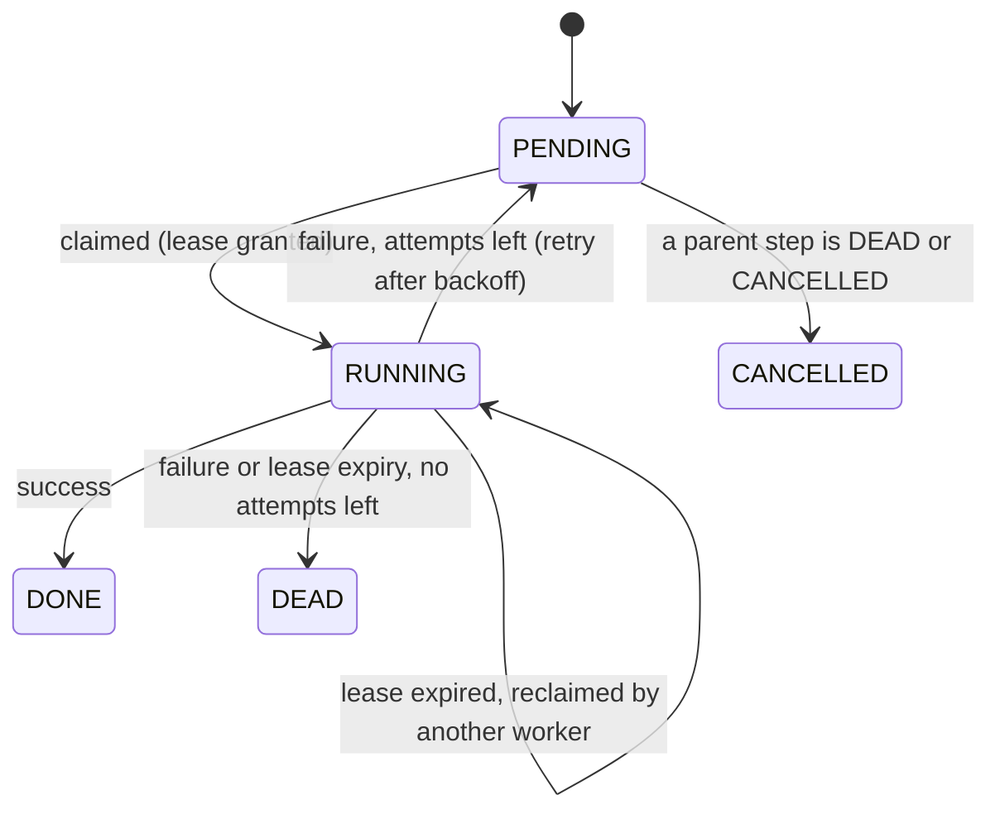

# Durable Workflow Engine


A small workflow engine built on **PostgreSQL** and **.NET 10**. It runs multi-step workflows (DAGs) across several worker processes and keeps going when workers crash, stall or fail.

I built it to understand why tools like Temporal and Airflow exist: what has to be true for background work to survive crashes, retry safely and never silently disappear.

## Chaos test results

250 steps (50 workflows of 5 steps each) were run by 4 workers while a script killed a random worker every 5 seconds.

| Check | Result |
|---|---|
| Worker kills during the run | **20** |
| Total run time | 109 seconds |
| Steps finished | **250 of 250** (none lost) |
| Steps that finished before a step they depend on | **0** |
| Steps re-executed after a worker died | 18 (268 executions in total) |
| Side effects applied | **250, each exactly once** |
| Duplicate side-effect requests caught and skipped | 8 |

Execution is **at-least-once**: when a worker dies mid-step, another worker re-runs that step, which is why there were 268 executions for 250 steps. Results are **effectively-once**: each step's side effect is protected by an idempotency key, so the repeats did no harm. See [Idempotent side effects](#idempotent-side-effects).

Each step simulates 1.5 seconds of work, so these numbers show correctness under failure, not raw throughput.

## How it works



All state lives in Postgres: steps, dependencies and execution history. Workers are stateless, so any number can run in parallel and any of them can crash at any time.

### Claiming work safely

A worker claims a ready step with one atomic statement (simplified):

```sql
UPDATE jobs
SET status = 'RUNNING', claimed_by = $1,
    lease_expires_at = now() + interval '8 seconds',
    attempts = attempts + 1
WHERE id = (
    SELECT j.id FROM jobs j
    WHERE (j.status = 'PENDING' AND j.run_after <= now()
           AND NOT EXISTS (SELECT 1 FROM job_dependencies d
                           JOIN jobs p ON p.id = d.depends_on_id
                           WHERE d.job_id = j.id AND p.status <> 'DONE'))
       OR (j.status = 'RUNNING' AND j.lease_expires_at < now())
    ORDER BY j.id
    FOR UPDATE OF j SKIP LOCKED
    LIMIT 1
)
RETURNING id;
```

- `FOR UPDATE SKIP LOCKED` means a worker never waits for a row another worker is claiming. It skips to the next ready step.
- The `NOT EXISTS` clause is what makes a step wait until all its parents are `DONE`.
- The second condition rescues steps whose worker died (expired lease).

### Leases, heartbeats and fencing

- Claiming a step grants an **8-second lease**.
- While working, a worker **renews the lease every 3 seconds** (heartbeat). If the worker dies, heartbeats stop and the lease expires.
- **Fencing:** every completion is `UPDATE ... WHERE claimed_by = me AND status = 'RUNNING'`. If the lease was lost and the step reassigned, the update changes 0 rows and the old worker's result is discarded.
- All lease timing uses the **database clock** (`now()`), never worker clocks, so clock skew between machines doesn't matter.

### Step states



### Retries

A failed step is retried with **exponential backoff and jitter**: about 2s, 4s, 8s... capped at 30s, multiplied by a random factor between 0.5 and 1.5 so failing steps don't all retry at the same moment. After 3 attempts the step becomes `DEAD`. Steps that depend on it are marked `CANCELLED` without ever running.

### Idempotent side effects

Because a step can run more than once, anything with a real-world effect (sending an email, charging a card) must be safe to repeat. Each step gets a stable idempotency key, `wf<workflow id>:<step name>`, which is the same on every retry. The demo handler records its effect like this:

```sql
INSERT INTO effects (idempotency_key, job_id, step_name, worker)
VALUES ($1, $2, $3, $4)
ON CONFLICT (idempotency_key)
DO UPDATE SET times_requested = effects.times_requested + 1
RETURNING times_requested;
```

The key is the primary key of the `effects` table, so it can exist only once. If `times_requested` comes back greater than 1, the handler knows the effect was already applied and skips it. In the chaos test, 258 requests reached this table: 250 were applied and 8 were recognised as repeats. A plain `INSERT` would have produced 258 rows.

## Guarantees

- **At-least-once execution.** A step may run more than once, never zero times (unless it is `DEAD` or `CANCELLED`).
- **Effectively-once side effects**, for handlers that use the idempotency key.
- **Dependency order.** A step never starts before all its parents are `DONE`.
- **No double claiming.** Two workers cannot claim the same step at the same moment. If a lease expires, the step is reassigned and the old worker's result is rejected.
- **Not exactly-once execution.** That is not achievable across a network boundary, which is why handlers must be idempotent.

## Failure modes and how they are handled

| Failure | How it is detected | What happens |
|---|---|---|
| Worker crashes mid-step | Lease expires (8s) | Another worker reclaims the step, attempt count increases |
| Worker crashes after applying a side effect | Lease expires, step re-runs | Idempotency key recognises the repeat, effect is not applied twice |
| Worker is slow, not dead | Heartbeat keeps arriving | Lease is renewed, step is left alone |
| "Zombie" worker finishes after losing its lease | Fencing check updates 0 rows | Its result is discarded, it stops working |
| Step fails | Handler reports failure | Retry with exponential backoff and jitter |
| Step always fails (poison step) | Attempts reach the maximum | Step marked `DEAD` |
| Worker keeps crashing on a step's last attempt | Lease expired with no attempts left | Step marked `DEAD` instead of retrying forever |
| A parent step is `DEAD` | Dependency check | All descendants marked `CANCELLED` |
| Worker clocks disagree | Not applicable | All timing uses the database clock |

## Submitting workflows

Workflows are written in YAML and submitted to the API:

```yaml
name: ingest-invoice
steps:
  - name: download
  - name: validate
    depends_on: [download]
  - name: enrich
    depends_on: [validate]
  - name: archive
    depends_on: [validate]
  - name: notify
    depends_on: [enrich, archive]
```

The API validates a workflow **before storing anything**: required fields, duplicate step names, unknown dependencies and dependency cycles (Kahn's algorithm). A workflow with a cycle is rejected with HTTP 400:

```
{"errors":["dependency cycle detected; steps involved in or blocked by it: a, b, c"]}
```

Valid workflows are saved in a single transaction, so workers never see half a workflow. Each step can set its own `max_attempts` (1 to 10, default 3).

## Run it

Prerequisite: Docker Desktop.

```
git clone https://github.com/damarisnteseng-bot/durable-workflow-engine.git
cd durable-workflow-engine
docker compose up -d --build
```

This starts Postgres, the API (http://localhost:5080) and 2 workers. Submit a workflow and check its status (the first workflow on a fresh database gets id 1000):

```
curl.exe -X POST http://localhost:5080/workflows --data-binary "@examples\invoice.yml"
curl.exe http://localhost:5080/workflows/1000
```

Watch the workers, scale them, or stop everything:

```
docker compose logs -f worker
docker compose up -d --scale worker=4
docker compose down
```

### Running the apps without Docker

Keep Postgres in Docker and run the API and workers with the [.NET 10 SDK](https://dotnet.microsoft.com/download/dotnet/10.0). Stop the containerised API and workers first, because they use the same port and database:

```
docker compose stop api worker
dotnet build
dotnet run --project src/Api
dotnet run --project src/Worker --no-build -- worker-A
```

### Configuration

Both programs read the database connection from the `DB_CONNECTION` environment variable and fall back to the local Docker database if it is not set. The API listens on the address in `API_URL` (default `http://localhost:5080`). Postgres is exposed on port 5433, and the development password is only for local use.

### Chaos test

The chaos test needs the .NET SDK and 250 demo steps. It starts its own workers, so stop the containerised ones first. This replaces any steps already in the database (Windows PowerShell):

```
docker compose stop api worker
dotnet build
type db\seed.sql | docker exec -i workflow-postgres psql -U workflow -d workflow
powershell -ExecutionPolicy Bypass -File .\chaos.ps1
```

On macOS/Linux use `cat db/seed.sql | ...` instead of `type`. The script refuses to start if there is nothing to process, and stops with an error if it cannot reach the database.

## Try it: crash a worker

With the stack running, watch the workers in one terminal:

```
docker compose logs -f --tail 0 worker
```

In a second terminal, queue 10 workflows and then hard-kill one worker container (Windows Command Prompt):

```
for /L %i in (1,1,10) do @curl.exe -s -X POST http://localhost:5080/workflows --data-binary "@examples\invoice.yml" -o nul
docker kill durable-workflow-engine-worker-1
```

The killed worker's in-flight step stops reporting. About 8 seconds later its lease expires and another worker picks the step up again (look for a line ending `attempt 2/3`; the `enrich-flaky` step is designed to fail once and shows `/5`). When the queue drains, every step is `DONE`:

```
docker exec -it workflow-postgres psql -U workflow -d workflow -c "SELECT status, count(*) FROM jobs GROUP BY status;"
```

Bring the killed worker back with `docker compose up -d`.

## Tests and CI

```
dotnet test
```

15 unit tests cover the workflow validator: cycles (including one hidden inside an otherwise healthy workflow), self-dependencies, unknown and duplicate steps, invalid settings, diamond-shaped fan-out/fan-in, and a 2,000-step chain. GitHub Actions builds the solution and runs the tests on every push.

## Design decisions

- **Postgres instead of Kafka or Redis.** Job state, dependencies and the queue live in one transactional store, so a claim and a state change can never disagree. The trade-offs are polling (workers check every second) and a single database as the throughput ceiling. I would move to a dedicated broker for very high throughput or multi-region workloads.
- **Leases instead of locks.** A lock held by a dead worker blocks forever. A lease expires on its own.
- **Lease longer than heartbeat interval.** An 8-second lease with a 3-second heartbeat tolerates one missed heartbeat without a false takeover.
- **Idempotency in the database, not in the engine.** The engine promises at-least-once execution and hands every step a stable key. The handler uses that key with a unique constraint to make its side effect safe to repeat.

## Bugs the tests caught

- **Livelock without heartbeats.** A 20-second step with an 8-second lease was stolen repeatedly by two workers, and neither could finish it. Heartbeats fixed this.
- **Attempts exceeding the maximum.** A step whose lease kept expiring never reported a failure, so it skipped the "give up after 3 attempts" rule (attempt counts reached 12). It is now marked `DEAD` once its lease expires with no attempts left.
- **A test script that reported success when it couldn't read the database.** The chaos script now stops with an error instead.

## Limitations and roadmap

Not built yet:

- Prometheus metrics, tracing and a dashboard
- Graceful handling of a database outage (workers currently crash if Postgres is unreachable)
- `LISTEN/NOTIFY` to replace polling
- Real step handlers (steps currently simulate work, and the idempotent effect is a demo)